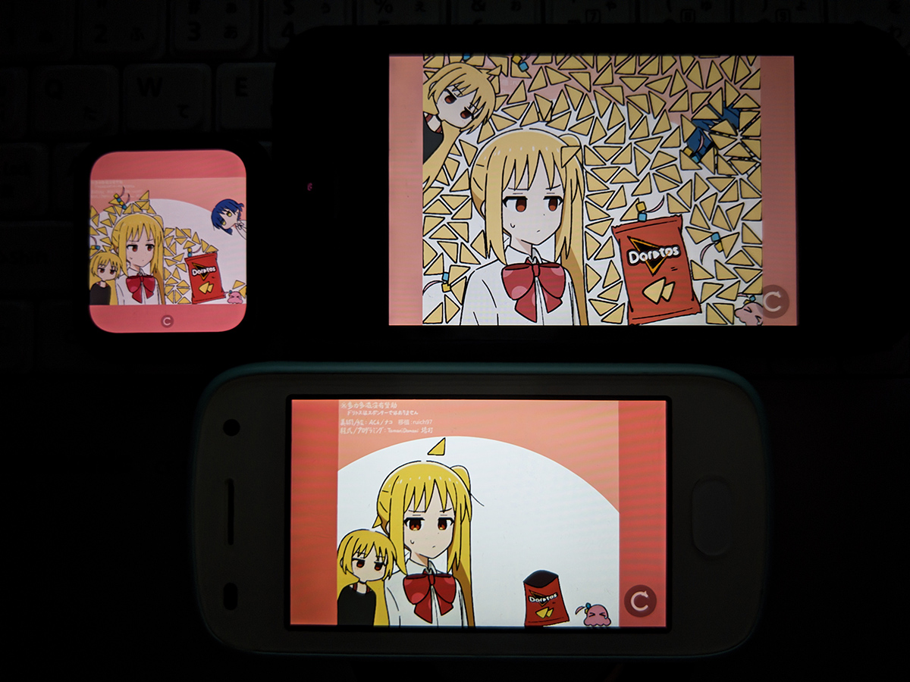

# Nijika's Ahoge — Android

[简体中文](README.md) | **English** | [日本語](README.ja.md)



**An unofficial Android port of *Nijika's Ahoge*.**

| | |
| --- | --- |
| Original work | **Nijika's Ahoge** |
| Original link | <https://tamanidamani.itch.io/nijikas-ahoge> |
| Original authors | **ACh (ナコ)** and **TamaniDamani (塔打)** |
| Permission | **Granted by both original authors**, on the conditions of **attribution** and **non-commercial use**. This port is **free of charge and free of advertising**. |

Originally a small browser game built with Construct 3. This port reimplements the entire game logic,
renderer and audio in **Kotlin**, swaps physics to **jBox2D 2.2.1.1**, and draws with
**OpenGL ES 2.0**. No game engine is used.

| | |
| --- | --- |
| Version | 1.2 (versionCode 3) |
| Package | `com.ruich97.nijikaahoge` |
| Minimum OS | Android 5.0 / API 21 |
| compile / target SDK | 35 / 35 |
| Graphics | OpenGL ES 2.0 |
| Native libs | None — one universal APK for armeabi-v7a and arm64-v8a |
| Size | ~2.36 MB (release APK) |
| Toolchain | Gradle 8.9 / AGP 8.7.3 / Kotlin 2.0.21 / JDK 17+ |

## Gameplay

Pull the ahoge out of Nijika's head and let them fall into the bag to collect them. Feeding a bag to
Ryo or Kita triggers different reactions, and a full gold bag summons Niji (Bocchi's little sister)
to celebrate.
Reaching **10 / 50 / 100 / 500 / 1000 / 5000** points fires a milestone easter egg, and Seika flies in
from four directions. The launch orientation follows the device default; after 1.5 s the view rotates
freely with the sensor. Both portrait and landscape work.

## Download and install

A prebuilt APK is published on the **Releases** page and installs directly (the source tree itself
contains no APK).

| Artifact | Size | Notes |
| --- | ---: | --- |
| `app-release_v1.2.apk` | 2.36 MB | release, signed — use this one |
| `app-debug.apk` | 2.62 MB | debug, supports ADB debug commands, not recommended for daily use |

SHA-256:

```
app-release_v1.2.apk  d56b8c45f76dc833ea5033660166ff50be6463a3699eef4331863a9f17d54bc6
app-debug.apk         e77a0794578e3bf473352cc5f6a706d87e68e6fa1bb5a1369daa8f41cfb42f40
```

Rebuilding changes the APK contents, so the checksums must be recomputed.

- Requires **Android 5.0 / API 21 or later** with **OpenGL ES 2.0**. There are no ABI-specific native
  libraries, so a single APK covers both armeabi-v7a and arm64-v8a.
- Package `com.ruich97.nijikaahoge`, version 1.2 (versionCode 3), targetSdk 35. The package name
  differs from the older `com.nijika.ahoge`, so this build **cannot be installed over the older
  release** — the two coexist as separate apps.
- The APK is signed with the Android **debug keystore** (`~/.android/debug.keystore`, certificate DN
  `C=US, O=Android, CN=Android Debug`, certificate SHA-256
  `935262ff0e7873606d8e311646907cc83ae43249b08f762b966114b82ef3830c`). That is a **development
  signature, not a Play Store production signature** — it cannot be used for store submission, and an
  APK signed with a different key cannot be installed over this one either. No keystore is included in
  this repository.
- A release APK you build yourself is **unsigned**; sign it with your own key before installing.

## Build

Requirements: JDK 17 or newer; Android SDK platform 35 and build-tools 35.0.0; either set
`ANDROID_HOME` or put `sdk.dir` into `android/local.properties` (that file holds a machine-local
path and is excluded via `.gitignore`).

```sh
cd android
# Windows
.\gradlew.bat assembleRelease
# Linux / macOS
sh ./gradlew assembleRelease
```

The first Gradle Wrapper run needs network access to download Gradle and the dependencies.
Add `--offline` once the cache is warm.

## Tests

**17** instrumentation tests cover the four fly-in mirror directions, the small Bocchi return,
drag-release velocity, fixture/cache consistency, off-screen bag state retention, milestones,
progress retention across EGL context recreation, 60/120/240-ahoge stress, finger-edge tolerance,
and exact-hit priority.

```sh
adb install -r android/app/build/outputs/apk/debug/app-debug.apk
adb install -r android/app/build/outputs/apk/androidTest/debug/app-debug-androidTest.apk
adb shell am instrument -w com.ruich97.nijikaahoge.test/android.test.InstrumentationTestRunner
```

`tools/build_render_atlas.py` regenerates `small_objects_atlas.png` and `render_atlas.json` from
`assets/frames/` (requires Python + Pillow). The atlas is committed, so normal builds need no Python.

## Implementation notes

### Module layout

| Path | Role |
| --- | --- |
| `MainActivity.kt` | Entry point, immersive fullscreen, lifecycle, sensor rotation |
| `GameView.kt` | SurfaceView + GL render thread, touch dispatch |
| `GameRenderer.kt` | Frame loop, letterbox viewport, layer-ordered draw |
| `game/Data.kt` | Parses `game_data.json` into types / animations / instances |
| `game/Obj.kt` | Object model, animation stepping, geometry (polygon / bounds / triangle caches) |
| `game/Phys.kt` | jBox2D world, fixture building, sleep/wake |
| `game/Sat.kt` | Separating-axis polygons and editor polygons |
| `game/World.kt` | Instance create/destroy, layer ordering, parent/child sync |
| `game/Logic.kt` | All game logic: pulling, contacts, feeding, milestones, particles, Seika, small Bocchi |
| `game/Game.kt` | Facade: `update` / `touch*` |
| `game/Sys.kt` | Tweens and sequence scheduling |
| `game/Parts.kt` | Particle emitters |
| `game/Snd.kt` | SoundPool audio: preload plus on-demand decode |
| `game/Vib.kt` | Haptic feedback |
| `gfx/SpriteBatch.kt` | Vertex batching, VBO orphaning |
| `gfx/Textures.kt` | Texture and atlas loading |
| `assets/` | `game_data.json`, `render_atlas.json`, `small_objects_atlas.png`, `frames/`, `media/` |
| `readme_pic/` | Banner image used at the top of the READMEs |

### Performance

- **Atlas merge**: 26 small ahoge and particle sprites are merged into one 512×512 atlas at original
  pixel size. Off-screen objects are culled, GPU vertex buffers are reused, per-frame object list
  filtering is replaced by type indices, and tweens are reused to cut per-frame allocations.
- **VBO orphaning (the biggest win in this release)**: `SpriteBatch.flush()` issues roughly 10
  `glBufferSubData` writes into the same VBO each frame, immediately followed by `glDrawElements`.
  Adreno performs buffer renaming, so it was never affected; Mali implicitly serializes when a buffer
  still in use is written — which explains why the *stronger* GPU was the slower one. The fix calls
  `glBufferData(..., DYNAMIC_DRAW)` before `subData` to orphan the buffer.

  | Device | Before | After |
  | --- | ---: | ---: |
  | Kirin 960 | ~35 fps | **steady 60 fps** |
  | Snapdragon 210 | nearly capped | steady 60 fps, noticeably cooler |
  | Snapdragon 410 | — | steady 60 fps |
  | Snapdragon W5+ Gen 1 | slightly dropped frames | ~55 fps |

- **Low-end frame throttling removed**: measured on Snapdragon 210 / Wear 2100, throttling did not
  improve thermals and only hurt drag feel. Every device now renders continuously, with long frames
  absorbed by dt clamping (cap 0.05 s, about a 20 fps floor). `lowEndProfile` now only selects the
  compact UI layout.
- **On-demand audio decoding**: SoundPool decodes serially on a single thread. The full 12-sound set
  is 28.5 s of audio; on low-end devices decoding it pegs one core for ~20 s and drags the render
  thread down to 30–47 fps for 20+ seconds. Only the most frequent short sounds are preloaded — the
  four smallest (pull 0.6 s, bag collect 0.26–0.49 s) plus `1` and `2`, which feeding always picks —
  6 sounds, 4.52 s total. On Snapdragon 210 the time to reach 55 fps dropped from 20+ s to ~8–10 s.
  Playback requests that collide with an in-flight decode now wait for the `onLoadComplete` callback
  instead of being silently dropped after a fixed retry window.

### Compatibility and fidelity

- Sound effects moved from Opus/WebM to **AAC/M4A**: on some Android 6 ROMs, WebM/Opus decoding falls
  back to a bundled ffmpeg plugin that hits `CHECK_EQ` → `abort()` on error — a native abort that Java
  `try/catch` cannot intercept, causing an immediate crash on launch. Switching to the platform
  decoder made that device run at a steady 60 fps.
- Minimum OS lowered from API 24 to **API 21**; lint reports **0** `NewApi` issues at minSdk 21.
- Seika's four fly-in directions now **mirror around the object origin** (vertices, bounds and
  collision polygon agree), fixing the older UV-only swap that made the visual position disagree with
  the collision position.
- The small Bocchi is explicitly woken before being teleported back; on release, linear and angular
  velocity are zeroed and the last drag position is synced; particles are restored to the original
  layers (Ryo / Kita on layer 3, Niji / Seika on layer 5).
- Finger input gets roughly **12 dp of tolerance** around the pullable ahoge polygon (capped at 96
  logical pixels). Directly hit bags and debris still take priority; mouse and stylus keep exact hit
  testing.
- Haptics: **9 ms** on grab / bag-collect, **55 ms** on a score milestone. API 31+ uses
  `VibratorManager`; devices without a vibrator are silently skipped.

## Known limitations

- A release APK built from this source is unsigned; no unified on-device benchmark across all models
  has been completed.
- Dense, tightly stacked collisions can still drop frames; round-screen cropping, sustained heat and
  power draw, and vendor audio implementations on older releases still need on-device acceptance.
- Game state survives rotation and a brief trip to the background only. If the process is reclaimed
  or you exit, the game restarts from the beginning — **there is no persistent save**.
- No cap on ahoge count, no collectible removal, and no reduction of Box2D solver iterations.

## License, permission and credits

### Original work

| | |
| --- | --- |
| Title | **Nijika's Ahoge** |
| Original link | <https://tamanidamani.itch.io/nijikas-ahoge> |
| Authors | **ACh (ナコ)** and **TamaniDamani (塔打)** |

**Permission: granted by both original authors**, on the conditions of attribution and
non-commercial use. This port is free of charge, carries no advertising, and ships no paid content
or ad SDK.

### Asset copyright (important)

All game artwork, audio, characters and other assets originating from the original work remain the
property of their **original authors (the artist)** and are **NOT covered by this repository's MIT
license**. This repository claims no copyright over them and grants no right to use them. The original
author's signature remains visible in the game visuals. Do not use the original authors' likeness or
official promotional art as a cover image — use your own gameplay screenshots instead.

### Code license

The source code written for this port is released under the **MIT License** — see [`LICENSE`](LICENSE).
That license applies **only to the code written for this project** and does not extend to any of the
original assets described above.

### Third-party components

- Physics via [jBox2D](https://github.com/jbox2d/jbox2d) 2.2.1.1, distributed under its original license.
- This repository is an **unofficial fan port**, unaffiliated with and not endorsed by the original authors.
